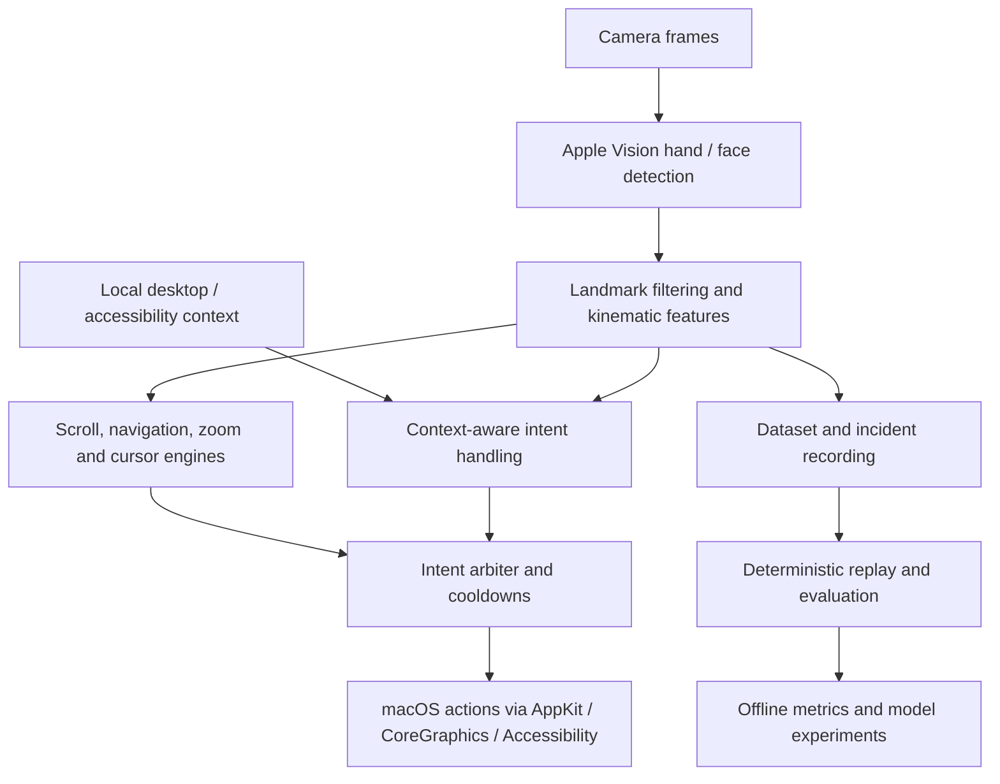

# Multimodal Intent Inference

<p align="center">
  <strong>GestureFlow — context-aware, hands-free interaction for macOS using hand motion and desktop context.</strong>
</p>

<p align="center">
  <a href="https://github.com/Thundercok/multimodal-intent-inference/actions/workflows/ci.yml"></a>
  <a href="https://www.swift.org/"></a>
  <a href="https://developer.apple.com/macos/"></a>
  <a href="https://developer.apple.com/documentation/vision"></a>
  <a href="https://developer.apple.com/documentation/coreml"></a>
</p>

---

## 1. Overview

This repository explores **multimodal intent inference for hands-free desktop interaction**. Its main runnable application is **GestureFlow**, a native macOS controller that turns camera-observed hand movements into system actions.

The interaction pipeline combines two kinds of context:

- **Visual and temporal hand signals:** Apple Vision hand-pose landmarks, normalized hand geometry, posture, motion, and gesture history.
- **Local desktop context:** active application and accessibility metadata, when the operating system exposes them.

The goal is not simply to recognize a pose. The system must distinguish deliberate interaction from incidental movement, prevent competing gesture modes from firing at the same time, and map accepted intent to predictable macOS actions.

GestureFlow currently uses a deterministic interaction pipeline as its live baseline. Learned classifiers and more ambitious temporal-control models are optional research components; they should not be confused with capabilities enabled by default.

## 2. Current Application Capabilities

The native Swift application includes:

- **Hand and face perception:** Apple Vision hand-pose and face-rectangle requests, producing 21 hand landmarks and face-proximity information.
- **Kinematic processing:** landmark filtering, geometric feature extraction, motion thresholds, and configurable sensitivity presets.
- **Gesture modes:**
  - **Air Scroll:** two-finger flicks with momentum and an immediate brake gesture.
  - **Mac Navigation:** horizontal and vertical swipes for Desktop Spaces, Mission Control, and Show Desktop.
  - **Spatial Zoom:** two-hand pinch-and-spread magnification.
  - **Spatial App Switcher:** open-palm arming followed by pinch-and-scrub selection.
- **Intent arbitration:** a shared arbiter, cooldowns, and explicit action commitment to prevent cross-gesture conflicts.
- **Desktop-context hooks:** accessibility context can help suppress ambiguous actions during text entry or resolve borderline interactions. Unavailable context is handled through a conservative fallback.
- **Data collection and replay:** guided/manual JSONL recording, incident capture, deterministic headless replay, and offline evaluation tools.
- **Optional Core ML components:** posture and temporal-intent inference hooks. The posture classifier is designed to run in shadow mode before any promotion to live actuation.

## 3. System Architecture



The native processing path is organized around these responsibilities:

| Component | Responsibility |
|---|---|
| `CameraManager` / Apple Vision | Camera capture and hand/face landmark detection |
| `HandFeatureExtractor` | Landmark cleanup, normalization, and kinematic features |
| `GestureEngine` / `ScrollEngine` | Mode-specific gesture state machines |
| `ContextIntentFusion` | Combines classifier output with available desktop context |
| `IntentArbiter` | Mutual exclusion, cooldowns, and committed-action tracking |
| `ActionSink` / `ActionDispatcher` | Scroll synthesis and macOS system actions |
| `DatasetRecorder` / `IncidentRecorder` | Local recording for evaluation and debugging |
| `ReplayRunner` | Deterministic offline execution over recorded streams |

For the full component map and threading model, see [System Architecture](docs/gesture/ARCHITECTURE.md).

## 4. Repository Layout

```text
multimodal-intent-inference/
├── GestureFlowApp/          # Native Swift / SwiftUI macOS application
│   ├── Sources/GestureFlow/
│   ├── Tests/GestureFlowTests/
│   ├── Package.swift
│   └── README.md            # App-level build, permissions, modes and controls
├── gesture_flow/            # Python research and reference implementation
│   ├── config/
│   └── core/
├── tools/                   # Dataset export, training, replay and evaluation scripts
├── docs/gesture/            # Architecture, model card, findings and evaluation notes
├── Assets/                  # Unity project assets
├── Packages/                # Unity package manifest
├── ProjectSettings/         # Unity project settings
├── HANDOFF.md               # Repository handoff pointer
└── RESEARCH_ROADMAP.md      # Longer-term research directions
```

The macOS application is developed and tested from `GestureFlowApp/`. The Unity project files are retained at the repository root; they are separate from the native Swift build.

## 5. Build, Test and Run

### Requirements

- macOS 14 or later.
- Xcode Command Line Tools with Swift 5.9 or later.
- Apple Silicon is the primary hardware target.
- Camera, Accessibility, and Input Monitoring permissions are required for the corresponding live features.

### Build and test the native application

From the repository root:

```bash
cd GestureFlowApp

swift build
swift test
```

Launch the application:

```bash
swift run GestureFlow
```

Start a guided recording session:

```bash
swift run GestureFlow --guided
```

Replay a previously recorded JSONL session:

```bash
swift run GestureFlow --replay /path/to/session.jsonl --tuning balanced --out /tmp/replayed.jsonl
```

### Run the Python tooling tests

From the repository root:

```bash
python3 -m unittest discover -s tools -p "test_*.py" -v
```

The GitHub Actions workflow builds and tests the Swift package on macOS 14 and runs the Python unit tests on pushes and pull requests to `main`.

## 6. Evaluation and Research Status

The repository includes tooling to inspect recorded sessions rather than relying only on subjective impressions:

- Frame-level classification metrics and confusion matrices.
- Per-class precision, recall, and F1.
- Idle false-alarm rate.
- Event-level gesture evaluation and action latency reporting.
- Deterministic replay for tuning and regression checks.
- Session-level feature export for posture-model experiments.

A replay throughput measurement is documented in [PERFORMANCE.md](docs/gesture/PERFORMANCE.md). It measures the feature-extraction and gesture-arbitration code path; it **does not** include camera capture, Apple Vision inference, or operating-system dispatch latency. It must not be interpreted as end-to-end application latency.

### Learned-model promotion is deliberately gated

The optional posture classifier is evaluated in shadow mode and is not enabled to control live gestures by default. The current [model card](docs/gesture/MODEL_CARD.md) marks real-recording validation as **blocked pending user sessions**. It requires held-out real recordings and comparison against the heuristic baseline before learned predictions can drive live actuation.

The temporal intent classifier also falls back when a compatible Core ML model is unavailable. The research roadmap describes future directions; proposed GNN/sequence-model and reinforcement-learning components are not claims about the current default runtime.

No end-to-end real-user accuracy figure is claimed here. See [Findings](docs/gesture/FINDINGS.md), [Robustness Notes](docs/gesture/ROBUSTNESS.md), and the [Research Roadmap](RESEARCH_ROADMAP.md) for scope, evidence, and open work.

## 7. Privacy and Local Data

The documented GestureFlow camera pipeline processes frames in memory and does not write raw camera images or video frames to disk.

Local recordings may still contain sensitive behavioral information. Depending on the recorder, they can include normalized hand landmarks, joint-confidence values, normalized face-bounding-box coordinates, ground-truth labels, timestamps, and engine state. These data can reveal interaction patterns even without raw images.

Recordings are stored locally under:

- `~/Library/Application Support/GestureFlow/recordings/`
- `~/Library/Application Support/GestureFlow/incidents/`

Do not commit personal recordings or share them without the recorded person's informed consent. Passive incident recording can be disabled in the application settings.

## 8. Further Documentation

- [GestureFlow application guide](GestureFlowApp/README.md) — build steps, permissions, modes, shortcuts, and recording.
- [System architecture](docs/gesture/ARCHITECTURE.md) — end-to-end pipeline, modules, and concurrency model.
- [Model card and promotion gate](docs/gesture/MODEL_CARD.md) — posture classifier scope and validation requirements.
- [Robustness notes](docs/gesture/ROBUSTNESS.md) — documented robustness conditions.
- [Performance benchmark](docs/gesture/PERFORMANCE.md) — replay microbenchmark and measurement scope.
- [Engineering findings](docs/gesture/FINDINGS.md) — implementation audits and resolved divergences.
- [Research roadmap](RESEARCH_ROADMAP.md) — planned research directions, separate from shipped functionality.

---

**Project focus:** dependable hands-free interaction through explicit intent handling, context awareness, measurable evaluation, and conservative failure behavior.
